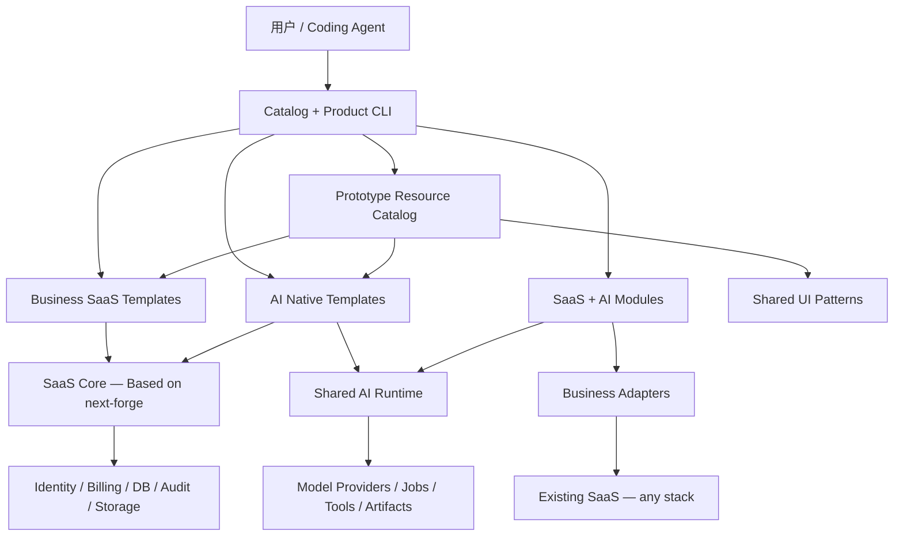

# 03 — 技术架构（Architecture Baseline）

## 1. 核心设计

next-forge 是**候选基础设施**，不是业务模板的平台上限。采用独立的 `SaaS Core`、`AI Runtime`、`Template Catalog` 和 `Integration Adapters`，防止单一框架绑死整个产品。



## 2. 预期边界

- **SaaS Core**：身份、组织、租户与权限、Billing、通知、日志、模块注册。
- **AI Runtime**：统一模型调用、流式输出、工具/MCP 接入、长任务、配额/成本与执行轨迹。
- **Template Catalog**：模板元数据、依赖、兼容性、安装动作、来源许可证、可重复验收。
- **Prototype Resources**：从属于 Business SaaS / AI Native Template 的设计/交互/前端实现变体；以 `templateId` 关联，声明依赖的能力和 bindings；复用独立的 UI Patterns。
- **Presentation Binding**：在 UI 的页面/交互与模板的公开业务/AI 能力间映射，禁止原型直接依赖私有数据库或修改领域规则。
- **Adapters**：对接特定 SaaS 的数据、动作、权限、上下文和业务事件。
- **Reference Apps**：演示真实可运行、可部署的组合，而非替代模块接口文档。

## 3. 初始仓库布局（概念，不表示已在上游存在）

```text
apps/
  app/                    # main SaaS application
  web/                    # marketing
  api/                    # API/webhooks
  docs/                   # documentation
  ...                     # retained next-forge apps
packages/
  billing-core/           # ours
  payments-stripe/        # ours / wrapped provider adapter
  payments-alipay/        # ours
  payments-wechat/        # ours
  jobs-core/              # ours
  ai-runtime/             # ours
  ai-copilot/             # ours
  adapter-contracts/      # ours
  ui-patterns/            # reusable presentation patterns (optional)
  ...                     # selected upstream packages
catalog/
  modules/
  business-templates/
  ai-native-templates/
  saas-ai-modules/
  prototype-resources/    # business / ai-native prototype manifests and assets
examples/
  business-pm/
  ai-workflow/
  saas-ai-pm-copilot/
```

布局需与实际 upstream Turborepo workspace 约束匹配，以 Phase 0 读取到的事实为准，不能在审计前强行迁移。

## 4. 依赖规则

1. `UI → application service → domain contracts → provider adapters`；禁止业务系统直接绕开 billing/permission contract。
2. SaaS Core 不应依赖某个业务模板；AI Runtime 不应 import 某个 CRM/项目管理的业务实体。
3. Adapter 允许依赖外部 SaaS SDK；模块核心只依赖抽象契约。
4. 模块间仅通过公开 exports/API、事件或受控数据库接口通信；禁止跨模块直接改私有表。
5. HTTP/OpenAPI 为跨语言默认接入边界，MCP 为 Agent 工具发现/调用的可选接口，不替代真实业务授权。
6. 原型依赖应用公开的 `capabilityId` 与授权执行入口；切换可兼容原型不能迫使领域模型、业务逻辑、数据表发生非声明式改动。缺失能力应拒绝自动装配，不能凭 UI mock 假装业务已实现。
7. 第三方商业服务必须在资产 manifest 记录成本、必要密钥、地域/部署约束以及替代方案。

## 5. 原型装配与运行边界

- Catalog 先解析 `application template/version → compatible prototypes`，同一应用模板可关联多个原型；不要求原型属于某一具体 UI 技术栈。
- 原型显式声明覆盖 `full-app / page / flow` 范围，并区分 `design-only / interactive-mock / integrated`；不能用静态稿替代可运行应用。
- 安装前比对 `requiresCapabilities` 与模板公开的 capability registry，检查 binding 完整性、权限要求、版本和第三方设计素材许可。
- 设计/演示数据不连接真实生产数据库；已集成原型只通过 application service/API 调用业务能力，不能绕过服务端权限。
- 切换原型默认不得迁移业务数据库；需要新业务能力时先明确更新应用契约与迁移方案，而不是默默改写业务核心。

## 6. 多租户、安全、AI 权限

- 每次请求携带由可信后端建立的 `principal / tenant / scopes`；不信任客户端提供的 tenant_id。
- 检索同时执行业务对象级 ACL；Embedding 索引也不得绕过 ACL。
- Agent Tool 执行入口重新鉴权，采用最小权限；高影响动作经过用户确认/审批策略。
- Prompt Injection 视为不可信输入，不能把检索文档里的指令当成授权。
- 对模型调用记录脱敏；默认不将密钥、支付凭证、敏感客户内容写入 traces。
- 超时、重试、成本上限与并发限流均在服务端生效。
- 模板安装与更新先进行依赖及权限差异预览，默认不执行不透明远端脚本。

## 7. AI 作业状态机（最小建议）

`QUEUED → RUNNING → SUCCEEDED | FAILED | CANCELED`，可选 `RETRY_WAIT`。

所有状态转移由持久化服务端控制；任何重试必须具备 idempotency key / execution attempt；失败后可查询到错误归类及对应 artifacts。模型输出不得直接触发状态机非法转移。

## 8. 部署方案

- 默认一套可自托管的 Next.js/Node.js + PostgreSQL 基础；对象存储、队列与 Worker 可按模板能力启用。
- 国内支付依赖公网回调、域名配置和合规商户资质；不得假定本地环境可完成所有真实支付。
- 不承诺所有代码可运行在 Edge；长耗时任务应交由后台 Worker。
- 提供锁定版本的依赖清单、环境变量 schema、数据库迁移及灾难恢复文档。

## 9. 升级与变更

- 锁定 upstream commit/tag，建立独立的 vendor delta 清单。
- 原版 upstream 包与自建包分开；第三方修改作为 patch 或单独 fork 可追踪。
- 升级前 CI 对比依赖、schema、权限/配置、测试与许可变化。
- Migration 要有前置检查、备份、向前兼容窗口及失败回退策略（数据库 DDL 不能简单承诺自动 rollback）。
