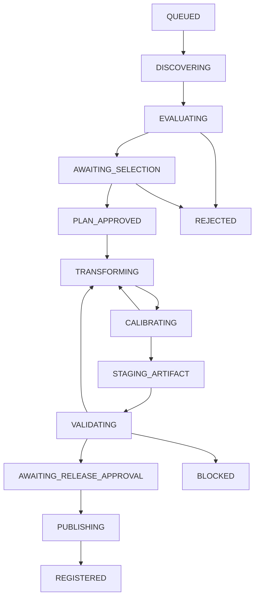

# 07 — 工厂任务状态机、权限和失败路径

## 三种不同状态机

**Target 生命周期**：`DRAFT → APPROVED → ACTIVE → PAUSED | COMPLETED | CANCELED`；批准过的目标可以派生多次生产 Job。

**ProductionJob 生命周期**：

可从任何非终态按授权进入 `PAUSED`, `BLOCKED`, `CANCELED`; `REJECTED`, `CANCELED`, `REGISTERED` 对单次 Job 为终态，后续修复另建 Job。`BLOCKED` 恢复只能回到先前记录阶段并重新验门；并非自动回到 `VALIDATING`。图只给主路径，实际以转移表为准。

**Artifact/Release 生命周期**：`STAGED → VERIFIED → RELEASE_APPROVED → PUBLISHED → DEPRECATED | QUARANTINED | WITHDRAWN`。Resource 的 `qualityLevel` 和 `publicationStatus` 不是 Job 状态。

## 强制门禁

| 转移 | 必须具备 | 决策权 |
|---|---|---|
| EVALUATING→AWAITING_SELECTION | 可信来源及初筛结论，风险可读 | Discovery/Reviewer |
| AWAITING_SELECTION→PLAN_APPROVED | ADR、许可计划、目标、预算、沙箱 | Product Owner + 安全/许可必要审查 |
| PLAN_APPROVED→TRANSFORMING | 锁定 SHA、checkpoint、路径白名单、执行批准 | Builder Controller |
| CALIBRATING→STAGING_ARTIFACT | 测试计划、代码 diff、影响清单 | Builder/Reviewer |
| STAGING_ARTIFACT→VALIDATING | 完整候选 payload 已冻结、哈希已锁、无后续写权限 | Build Controller |
| VALIDATING→AWAITING_RELEASE_APPROVAL | 所有强制 Gate PASS，证据锁定 | 独立 Validator |
| AWAITING_RELEASE_APPROVAL→PUBLISHING | 人类发行授权、许可和安全审查；所有 Gate 对应冻结 digest | Release Approver |
| PUBLISHING→REGISTERED | detached 签名/封套、安装和撤回路径验证；payload 不变 | Registry Controller |

## 可逆操作与幂等

所有转移持久化记录 `jobId`, `attemptId`, `from`, `to`, `actor`, `reason`, `evidenceIds`, `idempotencyKey`, `timestamp`, `checkpointId`, `artifactSha256`。同一转移重复请求只执行一次；不允许 LLM 直接写数据库状态字段，必须通过有授权的 Rules Engine。

验收后的返工必须撤销本次待发布资格、生成新的 payload digest 并重新跑相应 Gate。返工时不能修改旧证据的结果，只能追加新 attempt 和新证据；选择不同 Candidate 需要重走适当的 selection gate。构建失败不能跳过到发布；`UNKNOWN` 不能自动变 PASS。

## 停止策略

出现不可接受的许可风险/安全漏洞、预算耗尽、上游代码不可复现、重复失败超过阈值，应 `BLOCKED` 或 `REJECTED`，并输出：原因、已消耗成本、已完成制品、后续选项和回滚检查结果。已发布资源发现风险进入发布状态机 `QUARANTINED`，不要复用旧版本的新安装入口。

## V1.1 明确的失败与暂停语义

- `STAGING_ARTIFACT` 意味着候选 payload 已经被冻结并可计算 digest；没有 freeze 记录不可进入 `VALIDATING`。
- 进入 `VALIDATING` 后任何代码、打包内容或锁依赖修改，都必须创建新 attempt 和新 digest，重新进行受影响测试。
- `VALIDATING→BLOCKED` 可恢复的原因必须有人工或 rules engine 决策；不可跳过 STAGING 直接“重试发布”。
- `PUBLISHING` 阶段如遇同名版本 digest 冲突必须 BLOCKED，不能覆盖 Registry 里的 immutable 制品。
- 执行 Worker 重试不等于重新授权生产 API、真实支付或正式部署；此类动作永远需要独立审批。
