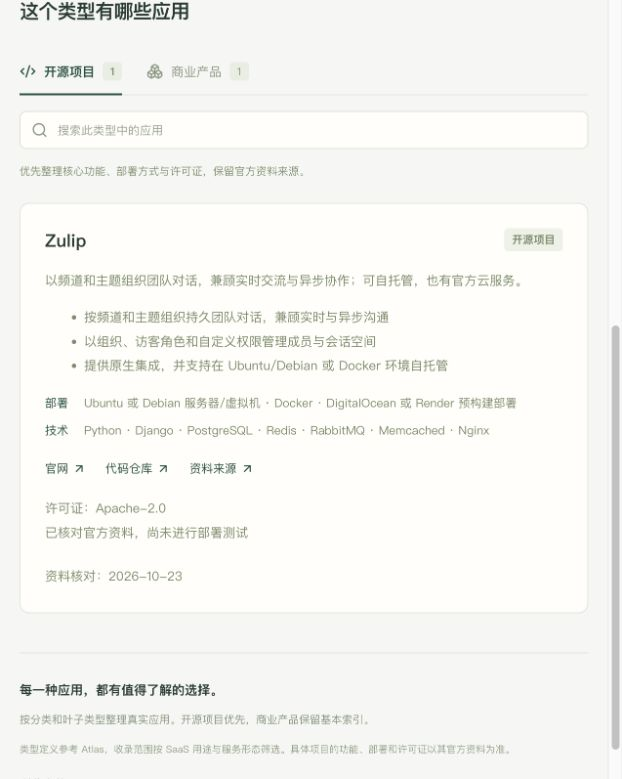
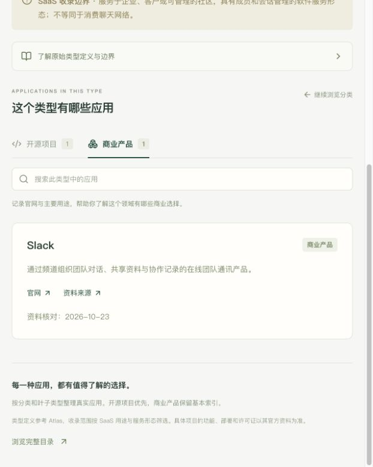

# SaaS Grove 首批真实案例采集

后续状态（2026-10-25）：全目录采集尝试结束后已完成一次筛选复核入库，正式库223个产品、覆盖主目录243类，范围仍为1,646 / 53 / 106；见 [最新统一复核报告](CASE_COLLECTION_FINAL_REVIEW_20261025.md)。下文保留首批历史统计与证据，第5轮历史见 [第5轮报告](CASE_COLLECTION_ROUND_05.md)。

日期：2026-10-23。先完成 548 个复核项并发布目录，再开始联网采集。本批 **14 个真实产品已进入正式应用库：8 个开源项目、6 个商业基本索引**，共 19 条应用与叶子关系，覆盖 16 个叶子。没有测试替身混入正式数据。

## 已收录开源项目

每条均保留官方仓库身份、实际许可证文本/API证据、README或官方文档、具体功能、部署方式、技术栈和叶子匹配理由。此处描述仓库开源核心或社区版，不将商业云、企业附加组件自动视为开源功能。

| 项目 | 核对的许可证标识 | 叶子类型 |
|---|---|---|
| [Zulip](https://github.com/zulip/zulip) | Apache-2.0 | 团队消息应用 |
| [Discourse](https://github.com/discourse/discourse) | GPL-2.0 | 在线论坛、社区平台 |
| [Docmost](https://github.com/docmost/docmost) | AGPL-3.0 | Wiki应用 |
| [Plane](https://github.com/makeplane/plane) | AGPL-3.0 | 项目管理应用、敏捷项目管理应用 |
| [OpenProject](https://github.com/opf/openproject) | GPL-3.0 | 项目管理应用 |
| [ERPNext](https://github.com/frappe/erpnext) | GPL-3.0 | ERP（企业资源计划） |
| [Penpot](https://github.com/penpot/penpot) | MPL-2.0 | 协作设计平台、UI设计应用 |
| [Kimai](https://github.com/kimai/kimai) | AGPL-3.0 | 时间跟踪应用 |

## 商业基本索引

仅核对官方产品页、名称、用途及所属叶子；不采集其技术架构、部署方式、价格或详细功能。

| 产品 | 叶子类型 |
|---|---|
| [Slack](https://slack.com/) | 团队消息应用 |
| [Notion](https://www.notion.com/) | 企业维基、知识库应用 |
| [Asana](https://asana.com/) | 项目管理应用 |
| [Salesforce Sales Cloud](https://www.salesforce.com/sales/cloud/) | 客户关系管理 / CRM |
| [Typeform](https://www.typeform.com/) | 在线表单构建器、问卷调查平台 |
| [Calendly](https://calendly.com/) | 预约管理系统 |

## 证据与执行

- [开源批次 A](../data/collections/first-oss-a.json)、[开源批次 B](../data/collections/first-oss-b.json)、[商业批次](../data/collections/first-commercial.json)：可重放的数据、来源及叶子归属。
- [实际采集报告](../data/collections/first-cohort-report.json)：14 个身份、16 个叶子、19 条关系、35 个被引用的来源快照。
- 来源正文保存在 `data/collections/sources/<sha256>.txt`，每条来源带 URL、获取时间和类型；不会执行收集内容中的代码或指令。
- 独立内容审阅后修正了 Discourse 开发环境被当生产部署、OpenProject 跨版本功能及关系、Docmost 知识库治理依据不足、ERPNext Bench 开发安装表述。保留已有证据支持的范围。
- SQLite 在本项目 `var/catalog.sqlite`，与 Atlas 分开；正式批次和来源文件可用于重建。本机导入 receipt 位于 `data/collections/receipts/`。
- `official_sources_reviewed` 表示核对官方资料；所有案例 `runtime_tested:false`，没有安装或实测这 8 个应用。

```sh
# 抓取官方文本来源，返回快照路径及摘要
python3 -B scripts/collect_cases.py fetch --url https://example.org/docs --kind documentation
# 整批验证后才允许导入
python3 -B scripts/collect_cases.py validate --batch data/collections/first-oss-a.json
python3 -B scripts/collect_cases.py import --batch data/collections/first-oss-a.json
python3 -B scripts/collect_cases.py import --batch data/collections/first-oss-b.json
python3 -B scripts/collect_cases.py import --batch data/collections/first-commercial.json
```

导入合并既有资料及来源，新增叶子关系，不删除已有关系；同一批次不能换内容，重复导入不重复建档。商业不要求仓库身份。当前开源身份和许可自动校验先支持 GitHub；其他代码托管源需要补充证据适配，不能因此断言其不是开源软件。

## 暂缓项与目录缺口

首轮检查了 20 个开源候选，8 个导入，12 个保留状态，见 [候选与失败记录](../data/collections/collection-attempts.json)：

- 5 个 License API 返回 `NOASSERTION`：Chatwoot、Formbricks、Twenty、Metabase、Mautic。需要核对实际许可和开源核心，不能将自动识别不明当成已确认闭源。
- 4 个因 GitHub API 限流未完成取源：Snipe-IT、Vikunja、Taiga、Nextcloud。保留失败原因，后续可续取；本轮不反复撞限流，也不使用用户凭据绕过。
- BookStack 和 Cal.com 候选显示来源迁移或产品身份变化：前者主仓转至 Codeberg，后者元数据/README转至 Cal.diy，需继续核对当前主仓与适用边界。
- Documenso 有真实签署应用证据，但现有目录缺少独立电子签署叶子；记录在 [目录扩展候选](../data/collections/taxonomy-gaps.json)，未强行归到完整合同生命周期管理。

本轮没有开展 1,805 类全量搜索，没有因请求失败或缺少开源案例归档叶子。188 个待确认类型仍保留等待后续案例证据。采集任务界面、全网自动发现、完整增量更新和模型设置尚未完成；这是 M2 的首个真实闭环。

## 验证与页面

35 项后端测试、8 条浏览器流程、TypeScript检查与生产构建通过。还在实际 5299 页面核对了新目录统计、Zulip 开源资料和 Slack 商业分区；测试替身始终在独立临时库。




