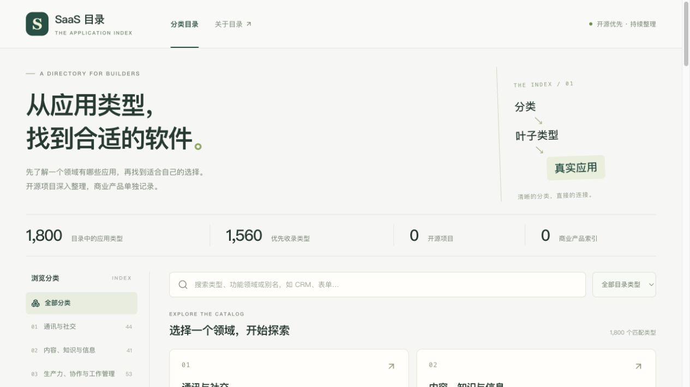
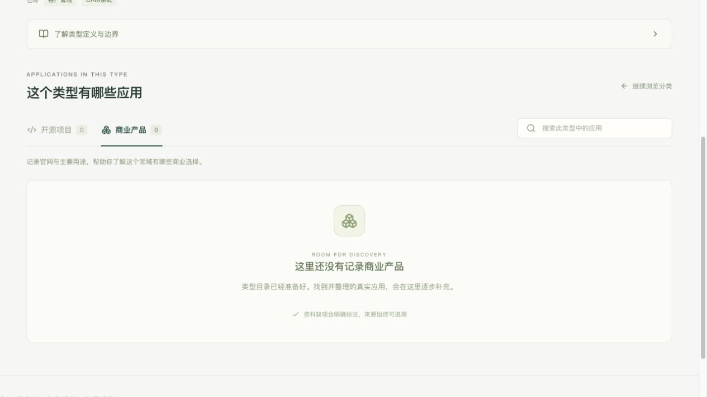

# M0 / M1：SaaS 分类目录首版

本文件保留 M0/M1 首版交付状态及当时截图。当前目录已完成 548 项复核发布，真实案例采集已开始，详见 [最新目录](SAAS_SCOPE_REVIEW.md) 与 [案例进展](CASE_COLLECTION_REPORT.md)。下文数量、空库描述与截图属于首版历史状态。

日期：2026-10-23。M0 目录数据与 M1 目录浏览已实现。新版独立于 Atlas 运行，目录没有场景层。

## 当前可用范围

- 保存 Atlas 全部 1,805 个源叶子，按子分类用途及叶子例外审阅 SaaS 边界；保留来源、定义、别名和原分类关系。
- 源快照保留 29 个大域、270 个分类节点；主目录包含 29 个大域、207 个子分类、1,464 个类型。181 个待确认类型另行筛选，160 个排除。详见 [边界修订](SAAS_SCOPE_REVIEW.md)。
- 分类浏览、按领域查看叶子、中英文／别名搜索、范围筛选、无结果重置。
- 叶子页的中文介绍、定义性核心、行为边界和来源说明。
- 开源与商业分区列表、各自计数与搜索、地址状态和刷新恢复。
- 统一应用 ID、跨叶子和跨分区关系、独立 SQLite 持久存储；目录和应用计数分开。
- 手机布局、加载失败重试、未知地址返回导航、键盘分区切换。

本轮采用用户确认的原则：**保证质量，完成比完美重要**。目录按用途与服务形态整理，模糊类型单列待确认，不默认进入主目录。没有把类型判断当作具体项目的部署认证。身份正确、目录结构完整、资料来源真实、列表分区和核心流程可用仍需验证。

## 尚未实施的范围

应用采集、模型整理、持久采集批次及商业条目录入界面在后续阶段。本机正式应用库目前为空，页面显示真实空态和零计数。浏览器测试中的两条应用明确为测试替身，仅存在于临时数据库，未写入正式库。

## 启动

Python 3.10+，Node.js 22。首次使用安装前端依赖：

```sh
cd web
npm ci
```

开发运行，在仓库根目录执行：

```sh
node scripts/dev.mjs
```

页面：<http://127.0.0.1:5288/browse>；API：<http://127.0.0.1:5299/api/health>。两者只监听本机，和 Atlas 的端口、数据、配置分开。

构建后也可只运行一个 Python 进程：

```sh
cd web
npm run build
cd ..
python3 -B -m server.api
```

此时直接访问 <http://127.0.0.1:5299/browse>。`var/catalog.sqlite` 是本项目本地应用库，不入 Git。目录来源与修订方法见 [目录数据说明](../data/taxonomy/README.md)。

## 验证

后端 9 项检查覆盖全量目录状态、分类结构、确定性重建、本地覆盖、别名搜索、分区及多叶子身份、重启持久化、API 参数与静态路径边界。浏览器 8 条流程覆盖分类到叶子、定义展开、开源／商业分区、刷新、搜索、空态、异常恢复、手机宽度与返回导航。

```sh
python3 -B -m unittest discover -s server/tests -v
cd web
npm run build
npm run test:e2e
```

初版验证输出保存在 `docs/m0-m1/`，目录边界修订后的结果见 `docs/scope-review/`。另外在实际运行的本机页面走查分类 → CRM 叶子 → 商业分区，正式库仍为空。预览：





## Atlas 复用与保留

本轮直接复用公开分类和叶子语料，保留稳定 slug、中文定义、别名与类型边界；导入时记录源 revision 和公开内容摘要。前端借鉴 Atlas 的分类导航、叶子卡片、异步加载取消、URL 筛选和状态展示，针对 SaaS 首版重新组织界面。依赖版本及锁文件沿用现有 Atlas 前端，保证本机已有版本可直接构建。

API 为本项目的精简只读实现，没有引入 Atlas 的工厂、开发工作台或场景服务。原有模板、实验和用户未提交修改保留，未启动历史模型批量任务。

下一步为 M2：把真实开源项目采集接入已经可用的叶子和应用列表。
