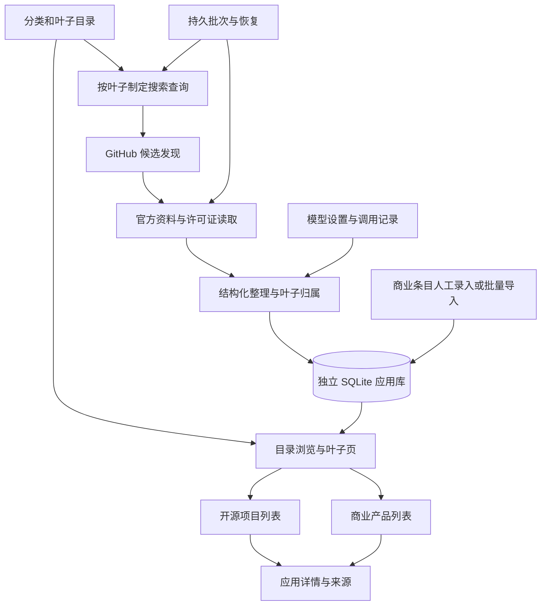

# SaaS 应用目录：新架构、Atlas 复用清单与开发计划

日期：2026-10-23。状态：M0 目录数据、M1 目录浏览已实施，见 [交付与验证](M0_M1_REPORT.md)；M2 已启动：具备官方来源快照、批次校验和事务导入，商业基本索引也已接入同一列表；自动发现、任务管理和后续里程碑尚未完成。当前正式库150个产品（37开源、113商业），最新见 [第5轮采集与确认](CASE_COLLECTION_ROUND_05.md)。详见 [采集进展](CASE_COLLECTION_REPORT.md)。用户确认“保证质量，完成比完美重要”，非关键边界可标注后继续。

## 1. 已确认的产品边界

- 产品形态参考 Atlas 当前的真实项目目录，范围聚焦 SaaS 应用。
- 组织结构是 **分类层级 → 叶子类型 ↔ 真实应用／项目**。一个应用可归属多个叶子，全库保存同一份应用身份。
- **没有场景层**：不建立场景实体，不生成场景，不要求应用先匹配场景才能收录。
- 开源项目优先收录、深入整理；商业产品单独展示，只记录名称、官网、简介、主要用途、所属叶子和来源。
- M0、M1 的当前实现以交付报告为准；下方包含后续阶段的数据结构及流程建议，不表示 M2–M5 已实现。

## 2. 参考版本与实际核对范围

参考仓库：`/Users/milin/2026/软件开发/application-atlas`，阅读时 HEAD 为 `0136ef93cc39d71724a8cd23455ac6142fa83bea`。

Atlas 当前目录有 **29 个大域、270 个目录节点、1,805 个叶子类型**。这里的 270 是源数据的 `sectionCount`，包含大域节点，不是另有 270 个二级分类。

Atlas 新目录相关的多个文件尚未跟踪，模型模块也有未提交修改，因此只写 HEAD 无法复现本次参考源码。逐文件路径、Git 状态和 SHA-256 已记录在 [复用证据清单](ATLAS_REUSE_EVIDENCE.json)。本次没有复制 Atlas 的数据库、凭据、运行缓存或项目收藏。

## 3. 目录先行

### 3.1 沿用分类和叶子的含义

沿用 Atlas 的多层分类、稳定 slug、中英文名称、别名、类型定义和边界。分类是导航容器；叶子代表应用类型，例如 CRM、开票软件、在线表单构建器。项目直接关联叶子。

```text
销售、客户与营收（Atlas 07）
  └─ 客户关系管理与账户管理（07.08）
       └─ 客户关系管理 / CRM（customer-relationship-management-crm）
            ├─ 开源项目
            └─ 商业产品

生产力、协作与工作管理（Atlas 03）
  └─ 表单与数据收集（03.11）
       └─ 在线表单构建器（online-form-builder）
            ├─ 开源项目
            └─ 商业产品
```

保留分类的实际深度，不强制每条路径恰好三层。目录展示数量与应用采集数量分别统计；空叶子也可以浏览定义和发起采集。

### 3.2 SaaS 是范围筛选，开源／商业是收录分区

分类按应用能力组织，不把“开源”“商业”“AI”各自另建一棵重复目录。开源与商业共用同一叶子，在列表、搜索和数量中分开。

SaaS 范围建议覆盖可作为在线服务提供的应用，也收录明确支持自托管的对应开源应用；不要求开源项目必须已有厂商托管版本。叶子适合 SaaS，并不能证明叶子下每个仓库都是 SaaS 应用，需要对具体候选核对。

库、SDK、纯 CLI、只支持本地使用的工具不默认进入应用列表。例如源目录的“命令行记账工具”不能因为与会计相关就自动收录为 SaaS。缺少部署资料的真实候选保留待补充，区别于已确认范围不符。

部署形态（自托管／厂商托管／两者都有／待核实）、许可证状态和商业模式分别记录。收费不代表闭源；仓库公开也不代表许可证已确认开源。待核验或受限源码项目应带明确状态，不能获得“已确认开源”标记。

### 3.3 最初草案与当前完整目录

当前 `data/taxonomy/` 保留完整源快照；经 SaaS 边界修订，1,805 个类型分为 1,646 个主目录、53 个待确认和 106 个排除。默认仅展示主目录；新增源叶子先进入待确认，原始快照与本地范围判断分开。见 [目录修订说明](SAAS_SCOPE_REVIEW.md)。

[SAAS_DIRECTORY_DRAFT.json](SAAS_DIRECTORY_DRAFT.json) 从现有 Atlas 类型中选取 **19 个大域、43 个下级分类、63 个叶子候选**，保留原 slug、分类归属、中英文定义、别名与来源摘要。

这是一份可核对的起点，**不是完整 SaaS 目录，也不是采集白名单**。所有条目均标记 `draft_candidate` / `needs_review`；本轮只核对了来源和目录关系，没有逐项证明 SaaS 适用性。没有选中的 Atlas 类型不等于应排除，后续应检查完整源目录。

| 源大域 | 草案中的代表叶子 |
|---|---|
| 通讯与社交 | 视频会议 |
| 内容、知识与信息 | 企业维基、知识库、CMS、无头 CMS |
| 生产力、协作与工作管理 | 项目管理、任务、看板、预约、表单、问卷、时间跟踪 |
| 商务、零售与市场 | 电商、B2B 电商、零售库存、POS |
| 营销、广告与增长 | 邮件营销、自动化、社媒管理、客户数据、营销分析 |
| 销售、客户与营收 | CRM、服务台、工单、客户聊天、反馈、客户成功 |
| 金融及财务 | 开票、订阅计费、费用、会计 |
| HR、劳动力与人才 | ATS、招聘、HRIS、入职、薪资 |
| 企业运营 | ERP、库存、仓库、审批、工作流、企业搜索 |
| 开发、数据、IT、安全 | 路线图、CI、功能开关、BI、企业 AI、数据集成、状态页、密码管理 |
| 行业应用 | 物业、建筑、LMS、会员、捐赠、活动票务、酒店、餐厅、健身、现场服务 |

目录第一阶段应检查 Atlas 全部叶子，记录保留、条件适用、排除和待判断的理由；原有类型的 slug 保持稳定。目录来源是可更新快照，SaaS 范围判断是本项目自己的版本数据，后续源目录更新不能覆盖本地判断。

## 4. 推荐架构

先沿用 Atlas 已有的本地运行形态：**React + TypeScript + Vite 前端，轻量 Python API 和采集进程，SQLite 存储**。本项目的数据对象是 SaaS 应用，当前不需要因此给目录平台本身引入租户、订阅和计费系统。



### 4.1 四个职责明确的部分

| 部分 | 职责 | 持久化内容 |
|---|---|---|
| 分类目录 | 分类树、叶子定义、范围判断、搜索词、Atlas 来源映射 | 版本化目录文件及导入索引 |
| 应用资料库 | 应用身份、叶子归属、分区、功能与部署资料、收藏、搜索 | SQLite |
| 采集与整理 | 搜索、候选去重、官方文档、许可、模型整理、增量更新 | 候选、来源缓存、调用记录 |
| 任务与设置 | 批次、进度、失败原因、继续执行、GitHub 与模型配置 | SQLite 任务状态与独立私有配置 |

运行时只读取本项目自己的目录快照、数据库和配置；不依赖 Atlas 服务在线，也不直接读写 Atlas 的运行库。

### 4.2 数据模型建议

| 对象 | 关键字段与约束 |
|---|---|
| `taxonomy_node` | 稳定 `id`、`parent_id`、`kind=category/leaf`、slug、名称、排序、源 Atlas ID；检查无环和父级存在 |
| `leaf_profile` | 叶子定义、别名、范围判断、纳入／排除理由、查询词、来源版本；使用本地覆盖记录接受源更新 |
| `application` | 全局 `app_id`、名称、官网、简介、部署形态、资料完整度、核对时间；不以 GitHub ID 作为所有应用的主键 |
| `application_catalog` | `app_id + track`，`track=open_source/commercial`；分开展示，同一产品可关联两种提供方式 |
| `repository` / `application_repository` | provider、数值仓库 ID、当前路径、应用关联；同一应用可有多个仓库，仓库转移不产生新身份 |
| `leaf_application` | 叶子与应用多对多、归属理由与来源、已确认／条件适用／待核实；不借用场景表 |
| `source_record` | 来源 URL、不可变版本或内容摘要、读取时间、来源类型；功能与部署事实关联来源 |
| `candidate` | 目标叶子、仓库身份或产品 URL、当前状态、理由、上次处理时间 |
| `collection_job` / `job_target` | 固定目标队列、处理阶段、尝试及错误、模型实际用量、继续位置 |
| `favorite` | 应用 ID 与本地收藏状态，更新资料时保持 |

先将身份、关系、筛选和任务状态做成可查询字段，较长的事实资料可继续用 JSON 保存，复用 Atlas 的实现方式。

商业去重不能按域名一刀切：同一厂商网站可能有多个产品。使用规范化产品 URL、厂商与名称形成重复提示，合并需保留原来源。一个开源项目已有商业托管版本时优先关联同一应用，不为两处分区各造一份互不相认的产品。产品版本确实不同则分开建档并建立关系。

### 4.3 采集流程

开源：叶子定义／别名 → 查询计划 → GitHub 搜索 → 保存候选及数值 ID → 核对公开身份 → 读取 README、许可证、功能与部署文档 → 提取事实 → 判断叶子归属 → 保存与更新。

- 查询计划直接由叶子产生，替换 Atlas 从场景生成查询的步骤。
- 不以 Stars 或“多久未更新”作为硬收录门槛；它们用于排序、提示或用户筛选。已确认无关的项目记录排除原因。
- 模型只能整理实际发现和读取的候选。资料不足保留缺项，模型不可用保存进度并暂停；不把模型记忆当成新项目来源。
- 初步收录与深入补充是两个可见阶段。第一阶段先确认项目与来源，随后补功能、技术栈和部署资料；明确每张卡片当前深度。
- 当前 Atlas 的官方文档选择最多补两份仓库文本，源码不在读取范围。它可作起点，但不足以承诺完整架构拆解；本项目需要补部署类文档选择规则并设置可配置的读取上限。
- 元数据未变化可以复用内容缓存；来源变化时刷新对应事实。重复执行保持身份、叶子关联和收藏，旧资料不因一次失败被清空。

商业：人工录入官网或导入清单 → 查重 → 确认基本官网来源 → 关联叶子 → 保存基本索引。第一版不需要自动全网爬取，也不采集价格史、做技术栈推断或详细功能评测。

### 4.4 页面与 API

建议页面：目录首页、分类浏览、叶子详情、应用详情、跨叶子搜索／收藏、采集任务、设置。

叶子页首先显示定义和边界，然后显示“开源项目／商业产品”两个独立列表或页签；默认开源。展示两种数量、资料完整度、许可证和更新时间，不展示场景筛选或场景覆盖率。

API 建议单独使用本项目的命名空间：

| API | 用途 |
|---|---|
| `GET /api/taxonomy`、`GET /api/leaves/:slug` | 分类树、叶子定义与资料统计 |
| `GET /api/applications?leaf=&track=&q=&license=&favorites=` | 统一应用查询，分区筛选 |
| `GET /api/applications/:id` | 应用详情与来源 |
| `POST /api/applications/:id/favorite` | 收藏 |
| `POST /api/commercial-applications`、`POST /api/commercial-imports` | 商业基本条目创建或导入 |
| `POST /api/collection-jobs`、`GET /api/collection-jobs/:id` | 指定叶子启动和查看采集 |
| `POST /api/collection-jobs/:id/resume` | 继续未完成目标 |
| `/api/settings/github`、`/api/settings/model/*` | 独立的凭据和模型设置 |

这些是待实现的接口建议。Atlas 当前 API 的 `scenario` 参数和 GitHub-only 主键不会成为新版契约。

## 5. 可以复用什么

这里的“直接复用”指逻辑或组件可保留，仍需在本项目接线和验证；不代表原文件连同路径、全局常量和运行数据原样复制即可工作。

| 能力 | Atlas 源码 | 复用判断与改动 |
|---|---|---|
| 分类、叶子名称和定义 | `atlas-web/public/data/meta.json`、`leaves/*.json`、源 `atlas.json` | 直接复用语料及稳定 ID，增加 SaaS 范围和来源版本；不把现有计数当作 SaaS 目录计数 |
| 分类浏览、按需展开、叶子卡片 | `src/routes/browse.tsx`、`components/leaf-card.tsx` | 结构可直接使用；改品牌、数据接口、跳转，加入各分区数量 |
| 按钮、徽标、加载／错误／空态 | `components/ui/*`、`components/loaders.tsx`、相关样式与工具函数 | 可直接提取，带上必要依赖和样式 |
| GitHub 读取、身份和失败处理 | `oss_catalog.py::GitHub`、`repository_metadata` | 复用处理逻辑；拆出客户端，改配置入口；不携带试点数据和默认叶子 |
| 官方文档、来源摘要及缓存 | `oss_sources.py` | 提取复用；去除对大目录模块的工具函数依赖，补 SaaS 部署文档选择 |
| 许可核对 | `oss_discovery.py::LicenseMatcher` 及相关函数 | 提取复用标准文本、缓存和受限许可处理；不把 GitHub 的 SPDX 元数据等同完整许可结论 |
| 模型请求、JSON 整理、缓存和实际用量 | `atlas_model.py`、`oss_discovery.py::Model`、`privacy.py` | 复用客户端及脱敏逻辑，改路径、配置命名和提示词；独立配置服务，不复制真实密钥 |
| 资料库、增量更新、收藏 | `oss_catalog.py::CatalogStore` | 需要改造：仓库主键改为全局应用身份，增加商业分区；移除 `oss_scenario`、`oss_match`；保留叶子关联和事务逻辑 |
| 自动发现与资料整理 | `oss_workflow.py`、`oss_discovery.py` | 需要改造：`prepare_leaf` 不再生成场景，`EXTRACT` 不再输出场景 `matches`；直接按叶子定义判断范围 |
| 持久批次与中断恢复 | `oss_batch.py::BatchJobs` | 复用队列冻结、继续、失败跳过和模型暂停逻辑；接入新存储与叶子准备器，重命名运行路径 |
| 项目卡片、筛选、收藏、进度 | `components/repository-catalog.tsx`、`repository-batch.tsx`、`lib/oss-catalog.ts` | 需要改造：去场景、去 PKM 试点默认值、使用全局应用 ID，增加商业基本条目与分区 |
| GitHub 和模型设置页面 | `github_settings.py`、`components/github-settings.tsx`、`routes/settings.tsx` | 提取相关面板和 API；环境变量、配置目录与端口独立 |
| 原子写入 | `atlas_runtime.py::atomic_write/atomic_json` | 直接提取函数，不连带复制 Atlas 的路径、凭据读取或语料发布入口 |
| 离线回归思路及测试替身 | `tests/test_oss*.py`、`test_github_settings.py`、`test_model_fallback.py` | 随改造迁移有效测试，删除场景前提，新增商业、目录和跨分区身份用例 |

关键耦合：当前 `oss_catalog`、`oss_workflow`、`oss_discovery`、`oss_sources` 和 `oss_batch` 相互引用；`atlas_model` 依赖 `atlas_runtime` 和 `privacy`。复制单个脚本并不能形成独立采集服务。建议把路径、错误、序列化、身份与 I/O 抽成小模块，再接新存储。

不必引入 Atlas 的整个 `drafts_api.py`、U17 开发工作台、模板工厂、场景管理、向量检索和旧生产数据库。这里不需要新建跨仓公共框架，先在本仓提取相关模块、记录来源和本地改动，便于独立运行和后续比较更新。

本仓 `toolbox/research/` 可复用功能清单、比较表和版本对比的产品呈现思路；其 `fetch.mjs` 有 Stars ≥100、两年内更新和必须有 README 的硬筛选，`summarize.mjs` 仅读 README 前 9,000 字符、默认 CLI 模型及固定工作目录，不适合作为新版采集主干原样保留。

## 6. 建议代码组织

```text
server/
  api.py                    # 精简 API，只接本项目功能
  config.py                 # 本项目路径、配置、端口
  taxonomy.py               # 分类、叶子和源版本导入
  store.py                  # 应用、关系、收藏、任务
  github_client.py
  sources.py
  licenses.py
  model_client.py
  collection.py             # 叶子查询、候选、整理、补充
  jobs.py                   # 批次、继续和失败记录
  tests/
web/                        # React + TS + Vite，提取相关 Atlas 组件
data/taxonomy/              # 可版本管理的目录与范围判断
var/                        # 本地 DB、缓存、配置及运行记录；不入 Git
docs/                       # 设计、来源清单及验证证据
```

目录快照与程序进入版本管理。凭据和个人状态在本地独立保存，应用公开快照导出不包含凭据、收藏或运行密钥。历史模板和实验目录保留，实施时不覆盖已有未提交改动。

## 7. 分阶段开发计划

| 阶段 | 具体交付 | 完成条件 |
|---|---|---|
| M0 目录数据 | 读取完整 Atlas 类型源，建立范围判断；保留分类与叶子；生成本项目目录和来源映射 | 每个源叶子有处理状态；目录无环、无孤儿、slug 唯一；草案与已采用条目可区分；可重复生成且本地覆盖不丢失 |
| M1 目录浏览 | 独立前端和精简 API；分类展开、叶子定义、分区页签、空态和搜索 | 新工作区启动成功；从分类到叶子可走通；没有项目的叶子可阅读；无场景页面或场景请求依赖 |
| M2 开源采集闭环 | 提取 GitHub、文档、许可、模型客户端；按叶子收录及补充；应用身份、来源与多叶子归属 | 三个不同类型叶子各完成真实采集，不凑固定项目数；重复采集不重复建档；缺资料可辨认，模型不能注入虚构仓库 |
| M3 持久批次与维护 | 多叶子队列、自动续批、错误和暂停、继续、增量、收藏、设置面板 | 用测试和一次实际中断验证只继续未完成目标；单项失败不阻塞队列；更新不清空收藏或其他叶子关系；无变化不重复整理 |
| M4 商业索引 | 商业条目创建／导入、官网来源、叶子关联、查重与已有开源应用关联 | 同一叶子两个分区各自可浏览搜索；商业条目不依赖仓库 ID；同域多产品不误合并；商业任务不触发深度采集 |
| M5 首版收口 | 跨叶子浏览、资料完整度和更新时间、公开快照、启动说明、完整流程检查 | 重启后目录／应用／任务／收藏保留；真实浏览器覆盖目录→叶子→开源详情→来源→收藏，以及商业导入→商业列表；导出无凭据 |

顺序为 **M0 → M1 → M2 → M3 → M4 → M5**。M0 建完整可扩展目录，M2 的三个叶子只是验证采集行为，不限制其他已采用叶子的使用。通过单个阶段后，代码完成与真实采集结果分别记录。

M2 建议先用 CRM、在线表单、订阅计费三个不同类型；是否能找到适合的真实项目以实际搜索为准。这是试点建议，不是已经收录的清单。

### 第一轮最具体的任务

1. 固定 Atlas 目录源版本，核对完整 1,805 叶子的 SaaS 范围；先从本次 63 条草案开始校正。
2. 定义目录文件 schema 和导入命令，稳定分类 ID、叶子 slug、来源映射与本地覆盖格式。
3. 实现精简目录 API，前端提取 Atlas 的分类浏览与叶子卡片。
4. 实现叶子详情和两个空列表，确认页面层不依赖场景、模板、工厂或 GitHub 试点。
5. 用真实浏览器验证分类展开、搜索、叶子详情、空态和刷新后的地址恢复。

第一轮的产物就是“可使用的 SaaS 目录”，不需要等待项目批量采集。之后再接采集闭环。

## 8. 本次验证及其限度

已对当前 Atlas 工作区执行以下五组离线测试，**61 项全部通过**：

- `test_oss_catalog`
- `test_oss_discovery`
- `test_oss_batch`
- `test_github_settings`
- `test_model_fallback`

测试使用临时数据库及网络／模型测试替身；执行器禁止 socket 连接，本次未发生网络连接尝试。完整输出见 [测试记录](ATLAS_REUSE_TESTS_2026-10-23.txt)。这支持复用相关处理逻辑，但不能替代移植后的回归、真实采集或页面验证。

目录草案的来源 slug、父级归属、中英文定义和内容摘要另做本地校验。本次没有部署新版应用、调用模型、开始批量任务、改动 Atlas 源码或提交 Git。

当前采集与类型确认进度见 [第5轮报告](CASE_COLLECTION_ROUND_05.md)，不会把初判或案例资料核对称为部署认证。
