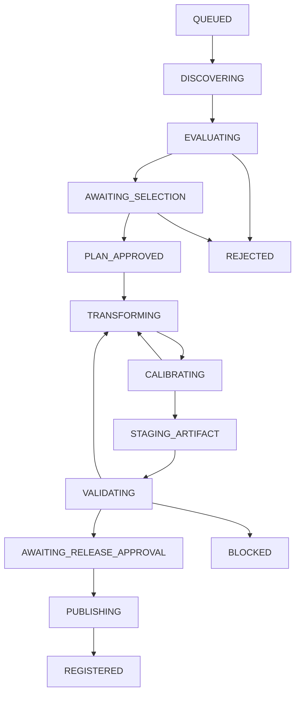

# 07 — 工厂任务状态机、权限和失败路径（PROPOSED V1.2 文本，待合并回 Source）

> ADR-Factory-001 提案修订版。**[V1.2]** 标出改动，主要是 CF-7（统一角色 + 完整转移表）。

## 三种不同状态机

**Target 生命周期**：`DRAFT → APPROVED → ACTIVE → PAUSED | COMPLETED | CANCELED`；批准过的目标可以派生多次生产 Job。

**ProductionJob 生命周期**：

**Artifact/Release 生命周期**：`STAGED → VERIFIED → RELEASE_APPROVED → PUBLISHED → DEPRECATED | QUARANTINED | WITHDRAWN`。Resource 的 `qualityLevel` / `publicationStatus` 不是 Job 状态。

## [V1.2 / CF-7] 唯一角色枚举

以下 6 个角色是**唯一**规范角色名，用于所有 `state-transition`、审批与决策记录：

`PRODUCT_OWNER | DISCOVERY_AGENT | BUILDER_AGENT | VALIDATOR | SECURITY_LICENSE_REVIEWER | RELEASE_APPROVER`

**旧称映射（不再使用）**：

| V1.1 旧称 | V1.2 规范角色 |
|---|---|
| `Builder Controller` / `Build Controller` | `BUILDER_AGENT` |
| `Registry Controller` | `RELEASE_APPROVER` |
| `Discovery/Reviewer` | `DISCOVERY_AGENT`（发现）/ `SECURITY_LICENSE_REVIEWER`（许可安全复核） |

`state-transition.schema.json` 的 `role` 是上述枚举；非规范名（如 `REGISTRY_CONTROLLER`）被 schema 拒绝。负例：`test_n9_non_canonical_role_and_builder_self_approval`。

## [V1.2 / CF-7] 完整转移表

图只给主路径；**以下转移表是唯一权威**。`role` 为可执行该转移的最小角色；`from`/`to` 取值即 `state-transition.schema.json` 的枚举。

| # | from → to | 必须具备 | 决策权（规范角色） |
|---|---|---|---|
| 1 | `QUEUED → DISCOVERING` | 已批准 BatchPlan、预算、只读范围 | PRODUCT_OWNER |
| 2 | `DISCOVERING → EVALUATING` | 只读发现结果与来源登记 | DISCOVERY_AGENT |
| 3 | `EVALUATING → AWAITING_SELECTION` | 可信来源及初筛结论，风险可读 | DISCOVERY_AGENT |
| 4 | `EVALUATING → REJECTED` | 无可信候选或全部 BLOCKED | DISCOVERY_AGENT + PRODUCT_OWNER |
| 5 | `AWAITING_SELECTION → PLAN_APPROVED` | ADR、许可计划、目标、预算、沙箱 | PRODUCT_OWNER（许可/安全必要时加 SECURITY_LICENSE_REVIEWER） |
| 6 | `AWAITING_SELECTION → REJECTED` | 选型否决理由 | PRODUCT_OWNER |
| 7 | `PLAN_APPROVED → TRANSFORMING` | 锁定 SHA、checkpoint、路径白名单、执行批准 | BUILDER_AGENT |
| 8 | `TRANSFORMING → CALIBRATING` | patch 已应用、测试前置调试计划 | BUILDER_AGENT |
| 9 | `CALIBRATING → TRANSFORMING` | 迭代修复（保留每次 attempt） | BUILDER_AGENT |
| 10 | `CALIBRATING → STAGING_ARTIFACT` | 测试计划、代码 diff、影响清单 | BUILDER_AGENT + SECURITY_LICENSE_REVIEWER |
| 11 | `STAGING_ARTIFACT → VALIDATING` | **完整候选 payload 已冻结、`ArtifactFreeze` 已产生、哈希锁定、无后续写权限** | BUILDER_AGENT（记录 freeze） |
| 12 | `VALIDATING → AWAITING_RELEASE_APPROVAL` | 所有强制 Gate PASS，证据锁定并绑定冻结 digest | VALIDATOR |
| 13 | `VALIDATING → BLOCKED` | 任一强制 Gate FAIL/BLOCKED/UNKNOWN，或证据过期 | VALIDATOR |
| 14 | `VALIDATING → TRANSFORMING` | 返工：新 attempt、新 digest、受影响 Gate 重验 | BUILDER_AGENT |
| 15 | `AWAITING_RELEASE_APPROVAL → PUBLISHING` | 人类发行授权、许可与安全审查；所有 Gate 对应冻结 digest | RELEASE_APPROVER |
| 16 | `PUBLISHING → REGISTERED` | detached 签名/封套、安装与撤回路径验证；payload 不变 | RELEASE_APPROVER |
| 17 | `PUBLISHING → BLOCKED` | 同名版本 digest 冲突 | RELEASE_APPROVER |
| 18 | 任意非终态 `→ PAUSED` | 暂停理由 | PRODUCT_OWNER |
| 19 | `PAUSED → <记录的先前阶段>` | 恢复理由；必须重新验证该阶段的 Gate | PRODUCT_OWNER |
| 20 | 任意非终态 `→ BLOCKED` | 阻断原因（许可/安全/预算/复现性） | 责任角色（至少 VALIDATOR 或 SECURITY_LICENSE_REVIEWER） |
| 21 | `BLOCKED → <记录的先前阶段>` | 人工或 rules engine 决策；**不得**直接跳 `PUBLISHING` | VALIDATOR 或 SECURITY_LICENSE_REVIEWER |
| 22 | 任意非终态 `→ CANCELED` | 取消理由 | PRODUCT_OWNER |
| 23 | `<非终态> → STOPPED_FOR_REVIEW` | 预算/时间/尝试次数上限触发 | PRODUCT_OWNER |
| 24 | `STOPPED_FOR_REVIEW → PAUSED | REJECTED | CANCELED` | 复审结论 | PRODUCT_OWNER |
| 25 | `REGISTERED → RECHECK` | 下载后重新哈希/重装复核 | RELEASE_APPROVER |
| 26 | `RECHECK → REGISTERED | BLOCKED` | 复核一致（同 payload）/ 不一致 | RELEASE_APPROVER |
| 27 | （资源级）`attestation REVIEW_DUE → 重签/降级` | 证据超期或上游变化 | VALIDATOR + RELEASE_APPROVER |

**终态**：`REJECTED`, `CANCELED`, `REGISTERED` 对单次 Job 为终态；后续修复另建 Job。

**命名统一 [V1.2]**：`STAGING_ARTIFACT`（本文 `07`）= `PACKAGE_CANDIDATE`（`05`）= payload freeze（`17`）。三者在 V1.2 统一为 **`STAGING_ARTIFACT`**，其余为历史别名，不再作为独立状态。

`REVIEW_DUE` / `STOPPED_FOR_REVIEW` / `RECHECK` 在 V1.2 有明确归属（转移 27 / 23 / 25–26），不再是悬空状态。

## 强制门禁与决策权（与转移表一致）

| 转移 | 必须具备 | 决策权 |
|---|---|---|
| EVALUATING→AWAITING_SELECTION | 可信来源及初筛结论，风险可读 | DISCOVERY_AGENT |
| AWAITING_SELECTION→PLAN_APPROVED | ADR、许可计划、目标、预算、沙箱 | PRODUCT_OWNER + 安全/许可必要审查 |
| PLAN_APPROVED→TRANSFORMING | 锁定 SHA、checkpoint、路径白名单、执行批准 | BUILDER_AGENT |
| CALIBRATING→STAGING_ARTIFACT | 测试计划、代码 diff、影响清单 | BUILDER_AGENT / SECURITY_LICENSE_REVIEWER |
| STAGING_ARTIFACT→VALIDATING | 完整候选 payload 已冻结、哈希已锁、无后续写权限 | BUILDER_AGENT |
| VALIDATING→AWAITING_RELEASE_APPROVAL | 所有强制 Gate PASS，证据锁定 | VALIDATOR |
| AWAITING_RELEASE_APPROVAL→PUBLISHING | 人类发行授权、许可和安全审查；所有 Gate 对应冻结 digest | RELEASE_APPROVER |
| PUBLISHING→REGISTERED | detached 签名/封套、安装和撤回路径验证；payload 不变 | RELEASE_APPROVER |

## 可逆操作与幂等

所有转移持久化记录（`state-transition.schema.json`，**V1.2 新增**）：
`jobId, attemptId, from, to, actor, role, reason, evidenceIds[], idempotencyKey, timestamp, checkpointId, artifactSha256`。

同一转移重复请求只执行一次；不允许 LLM 直接写数据库状态字段，必须通过有授权的 Rules Engine。**Builder 不能自批发布**：转移 12/15/16 由 `BUILDER_AGENT` 执行会被 `factory_rules.check_state_transition` 拒绝（负例 `test_n9...`）。

验收后返工必须撤销本次待发布资格、生成新的 payload digest 并重跑相应 Gate。返工时不能修改旧证据结果，只能追加新 attempt 与新证据；选择不同 Candidate 需重走适当 selection gate。构建失败不能跳过到发布；`UNKNOWN` 不能自动变 PASS。

## 停止策略

出现不可接受的许可风险/安全漏洞、预算耗尽、上游不可复现、重复失败超阈值，应 `BLOCKED` 或 `REJECTED`，并输出：原因、已消耗成本、已完成制品、后续选项和回滚检查结果。已发布资源发现风险进入发布状态机 `QUARANTINED`，不复用旧版本新安装入口（`factory_rules.check_installable` 强制 `WITHDRAWN/QUARANTINED` 禁止新安装）。

## V1.1/V1.2 明确的失败与暂停语义

- `STAGING_ARTIFACT` 意味着候选 payload 已冻结且可计算 digest；**没有 `ArtifactFreeze` 记录不可进入 `VALIDATING`**。
- 进入 `VALIDATING` 后任何代码、打包内容或锁依赖修改，都必须创建新 attempt 和新 digest，重新进行受影响测试。
- `VALIDATING→BLOCKED` 的恢复必须有人工或 rules engine 决策；不可跳过 STAGING 直接“重试发布”。
- `PUBLISHING` 阶段同名版本 digest 冲突必须 BLOCKED，不能覆盖 Registry 的 immutable 制品。
- 执行 Worker 重试不等于重新授权生产 API、真实支付或正式部署；此类动作永远需要独立审批。
